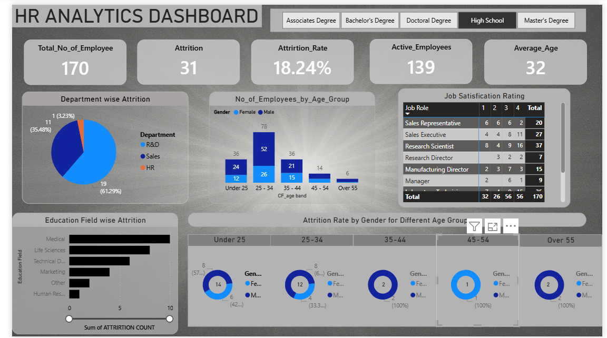

# HR Analytics Dashboard (Power BI)

**A one-page Power BI dashboard that shows where and why employees leave.**

## What it shows

- **Headline numbers:** 170 employees, 31 who left, an attrition rate of 18.24%, 139 active employees, and an average age of 32.
- **Attrition by department:** how the people who left split across R&D, Sales and HR.
- **Employees by age group:** headcount in each age band, split by gender.
- **Job satisfaction by role:** satisfaction ratings from 1 to 4 for each job role.
- **Education filter:** buttons to view the whole dashboard for one education level at a time (high school, associate, bachelor's, master's or doctoral degree).

## Files

- `pbhr.png`: screenshot of the dashboard

The Power BI file (.pbix) is not in this repo yet.
